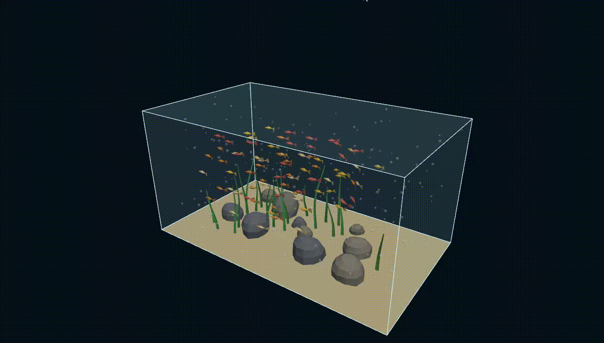
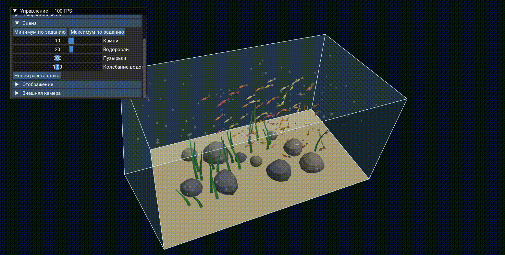
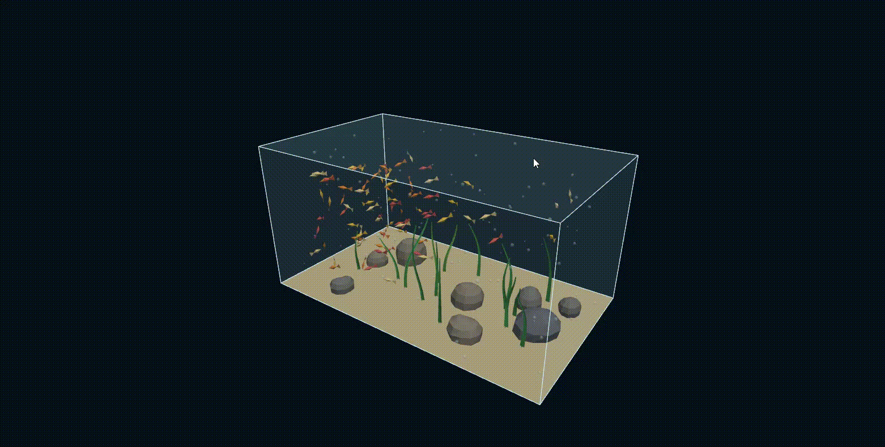
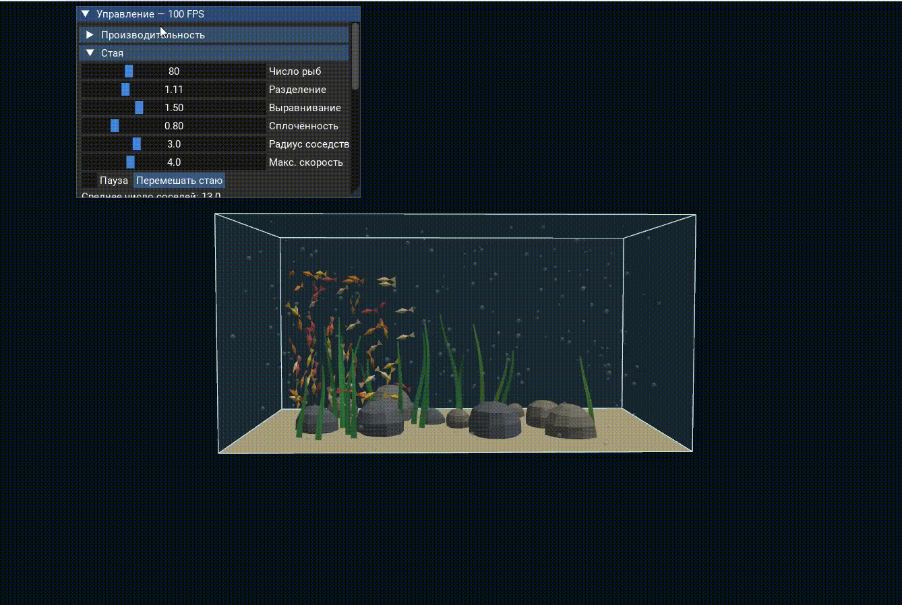
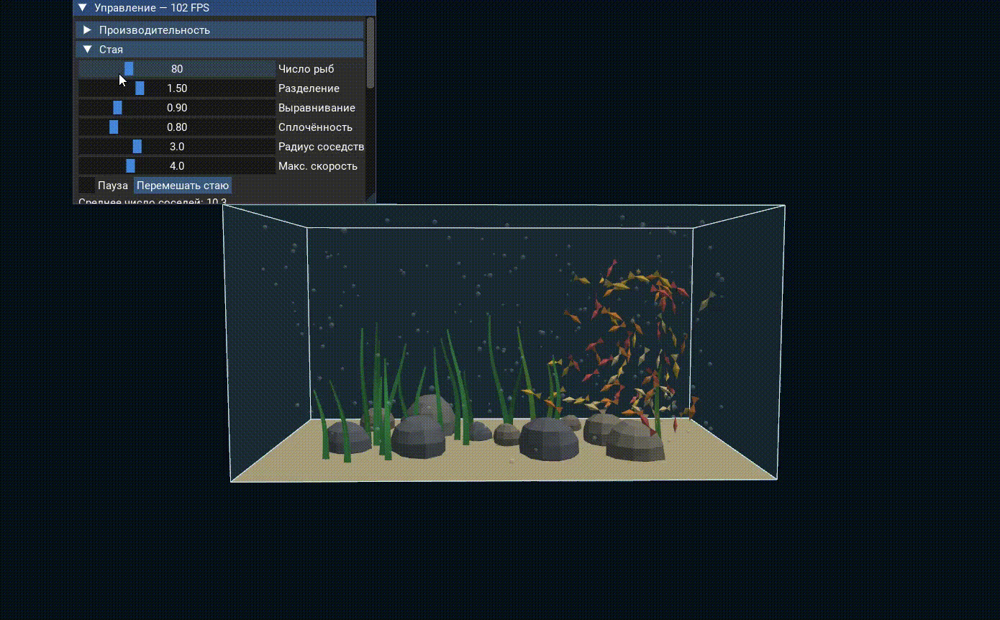
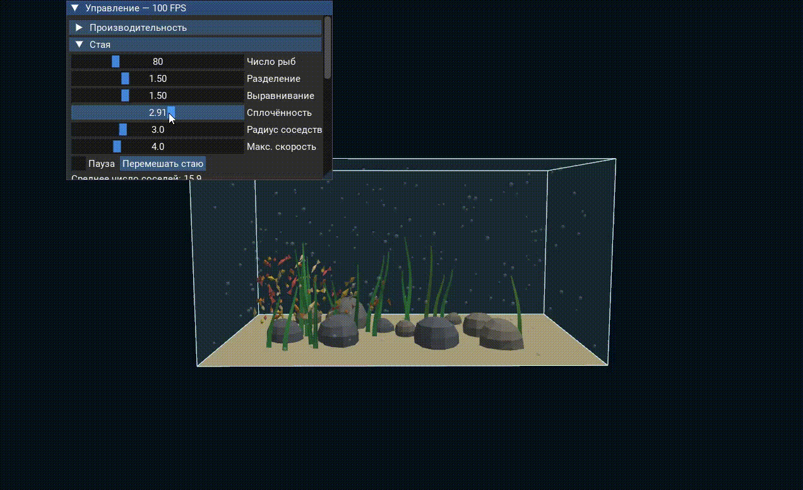
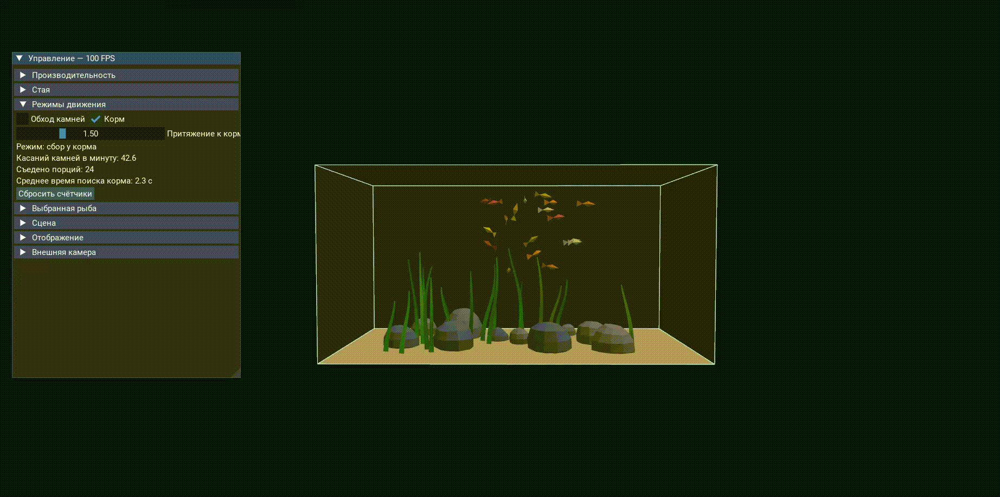

# Аквариум со стаей

Интерактивный трёхмерный визуализатор аквариума со стаей рыб, реализованный на Python средствами OpenGL.

Курсовая работа (исследовательская практика) на тему
«Разработка интерактивного визуализатора аквариума со стаей средствами OpenGL».

## О проекте

Стая из 10–300 рыб движется по модели Boids (C. Reynolds, 1987): каждая рыба следует трём
локальным правилам — разделению, выравниванию и сплочённости, — и из них возникает согласованное
движение всей стаи. В аквариуме лежат камни, качаются водоросли, поднимаются пузырьки, а по
объёму движется корм. Стая плавает свободно, обходит камни или собирается у корма. Можно выбрать
любую рыбу, увидеть её соседей и действующие на неё силы или смотреть камерой, которая плывёт
следом. Все параметры меняются на ходу в панели управления.

Исследовательская часть: как веса правил и радиус соседства влияют на поведение стаи, насколько
обход уменьшает столкновения с камнями, как быстро стая находит корм и как время расчёта зависит
от числа рыб.



### Возможности:

- Аквариум с полупрозрачными стенками и рёбрами; камни (до 15), водоросли из 8–12 сегментов
  (до 30), пузырьки (до 400).
- Стая из 10–300 рыб; веса трёх правил, радиус соседства и скорость настраиваются.
- Рыбы не проходят сквозь стёкла, камни и друг сквозь друга при любых настройках.
- Режимы движения: свободное, обход камней, сбор у движущегося корма; режимы сочетаются.
- Выбор рыбы щелчком: сфера соседства, подсветка соседей, их число, векторы сил.
- Внешняя камера вокруг аквариума и камера за выбранной рыбой.
- Показатели: FPS, время шага симуляции, согласованность стаи, касания камней, время поиска корма.

## Установка 

```powershell
python -m venv .venv
.venv\Scripts\Activate.ps1
python -m pip install --upgrade pip
pip install -r requirements.txt
```

Библиотеки устанавливаются в папку `.venv` внутри проекта и не смешиваются с другими проектами.
Если PowerShell сообщает, что выполнение сценариев отключено, один раз выполните
`Set-ExecutionPolicy -Scope CurrentUser RemoteSigned` и повторите активацию.

## Запуск

```powershell
.venv\Scripts\Activate.ps1
python main.py
```


## Управление

| Действие | Результат |
|---|---|
| Щелчок по рыбе / по пустому месту | выбрать рыбу / снять выбор |
| Левая кнопка + движение, колесо | вращение и приближение внешней камеры |
| Пробел | пауза |
| C | камера за выбранной рыбой / внешняя камера |
| Esc | снять выбор |
| R | вернуть камеру в начальное положение |
| H | скрыть или показать панель |

Панель «Управление» (FPS — в её заголовке): разделы «Производительность», «Стая»,
«Режимы движения», «Выбранная рыба», «Сцена» (в том числе составы «Минимум» и «Максимум»), «Отображение», «Внешняя камера».

## Демонстрация основных сценариев

### Генерация структуры аквариума


### Управление камерой


### Изменение параметра "Разделение"


### Изменение параметра "Выравнивание"


### Изменение параметра "Сплочённость"


### Режим "Добавление корма"


## Структура проекта

```
main.py                точка входа
aquarium/
  app.py               окно, интерфейс, главный цикл, управление мышью
  config.py            все настройки: размеры, цвета, параметры камеры
  mathutils.py         векторы и матрицы
  camera.py            камера, вращающаяся вокруг аквариума
  geometry.py          вершины дна, стенок, рёбер и модели рыбы
  flock.py             стая по модели Boids (без OpenGL)
  neighbors.py         поиск соседей
  renderer.py          шейдерные программы, буферы вершин, порядок отрисовки
  ui.py                панель управления
  shaders/             шейдеры на GLSL
```